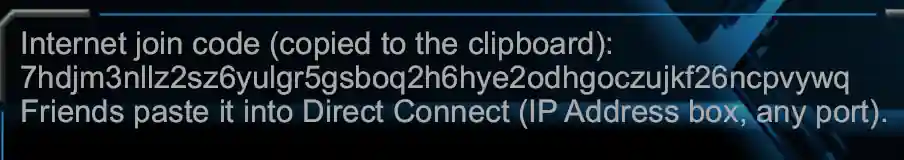
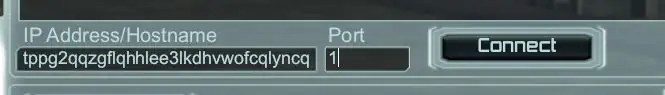

# RTS Core Engine

A from-scratch reimplementation of the Supreme Commander: Forged Alliance engine.

With a strong focus on perforance and cross platform (ARM, x86, windows, mac, and linux) determinism.

It runs [FAF](https://www.faforever.com)'s Lua unchanged.

It attempts to stay as faithful to the orginal Supreme Commander as possible, only differing in direct tech upgrades (such as networking).

No game data ships with it: you need your own copy of Forged Alliance (Steam or GOG) and FAF's Lua.

A blog style posting of the progress can be found [HERE](https://forum.faforever.com/topic/10451/supcom-moho-engine-rewrite)

## Just get me running

To just get playing, download the latest 

If you have faf installed it will auto pick up your maps and mods.

### Multiplayer

*Host:*
Main Menu -> Mulitplayer LAN -> Create -> (input game name)

_You will get an join code like so (its auto copied to your clip board)_


*Join:*
Main Menu -> Mulitplayer LAN

_at the bottom in the ip address box input the code, and in the port input 1_



## Requirements

- **Rust**: the pinned nightly in `rust-toolchain.toml` (rustup installs it on the first build).
  Every machine and every lockstep peer builds with the same compiler.
- **Forged Alliance**: the game install, found automatically from Steam, GOG or the FAF client,
  or given with `--game-dir <DIR>`.
- **FAF's Lua**: the FAF client's data folder, or a checkout of
  [FAForever/fa](https://github.com/FAForever/fa), found automatically or given with `--fa <DIR>`.
  For development, put `fa` and `Supreme Commander Forged Alliance` beside this repo.
- **Linux**: `libasound2-dev` and `pkg-config`; Vulkan drivers.


## Running this repo

_For development, put `fa` and `Supreme Commander Forged Alliance` beside this repo._
```sh
cargo run --release                             # main menu
cargo run --release -- --session                # straight into a skirmish against the AI
cargo run --release -- --session --speed max    # sim as fast as it goes
cargo run --release -- --headless --ticks 400   # no window: 400 ticks (40 game seconds)
cargo run --release -- --help                   # every option
```

The engine logs to `game.log`. Use `--release` for long runs.

## 10,000 foot view

Alittle bit of my high level ideas and thoughts for the project.

First are goals:

- Full cross platform 
    - windows, linux and arm.
    - ARM and x86
- Really Fast
    - multicore first and forthmost
- Modern tooling and Dev experience
    - testing
    - benchmark
    - nice development eco system

Techwise this has lead me to basically pick the following key parts

- Rust
    - It's a modern version of cpp, even just it's 3rd party eco system ease of intergration is enough justifaction, let alone the language its self
    - multicore is much much easier here than cpp, and while the lua can't be multithreaded, everything else absolutly can be.
- Fixed point math
    - It may be slower than floating point, but it's the same across arm and x86, and just removes a whole host of issues
- Luau
    - The supcom game is really controlled by its lua scripting langauge
    - cross platform between arm and x86 instantly rules out any form of jit both in luau and luajit
    - luau is the fastest of the lua vms I could find
    - importantly it supports typed lua, dev ux is very important and types are the number one way to achieve this
- Iroh for networking
    - Supreme commander is peer to peer, while this means you don't need any strong server to run the game, you do need a way to connect to peers behind all sorts of crazy internet setups.
    - Iroh handles this all transparently for you, each peer can direct connect with just a unique game code. They will either direct connect, or where not possible will go via a relay, it even handles internet switching mid connection.
    - The relay can be self hosted
- Profiling
    - Software is only as fast as you can measure
    - Tracy for high level flame graph style profiling
    - Testing and benchmarking for the rest


## Tests / Benchmarks

```sh
cargo test                                 # needs the game data above
RTS_SKIP_DATA_TESTS=1 cargo test           # without it (what CI runs)
cargo clippy --workspace --all-targets -- -D warnings   # lints, incl. the sim's determinism bans
```

CI fails on any clippy warning. [`CONTRIBUTING.md`](CONTRIBUTING.md#tests) lists the checks to run before a PR.

```sh
cargo bench                                 # needs the game data above
```

## Docs

[`docs/guides/running.md`](docs/guides/running.md) has all the run modes, flags, tests and benches.
[`docs/README.md`](docs/README.md) indexes the rest of `docs/`, and [`CONTRIBUTING.md`](CONTRIBUTING.md) covers setting up and the rules for changes.

## Licence

See [LICENSE](LICENSE). Not affiliated with or endorsed by Square Enix, Gas Powered Games or FAForever.
